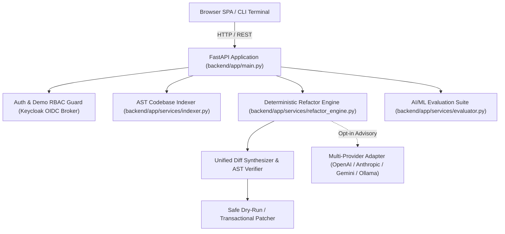

# ai-pair-programmer-alan-vo — Alan Vo | AI & Machine Learning

> Work in progress. This checkpoint may be incomplete or fail tests. See PLAN.md and STATUS.md before use.


ai-pair-programmer-alan-vo addresses the challenge of automated codebase refactoring by combining AST-based dependency graph indexing with deterministic multi-file diff synthesis and opt-in LLM advisory reasoning. Designed for software engineers, machine learning system developers, and platform teams, the application statically parses symbols, analyzes cross-file caller impacts, and validates syntactic correctness before code edits are written to disk.



## Features

- **AST-Based Context Extraction**: Deep static analysis parsing Python ASTs (classes, functions, async routines, imports, and caller hierarchies) alongside multi-language support (TypeScript, JavaScript, Go, Rust).
- **Deterministic Refactor Synthesis**: Offline rule-based refactoring engine capable of coordinated symbol renames, retry backoff wrappers, and audit log insertions without external API dependencies.
- **Unified Diff Generation & AST Gate**: Automatically constructs standard unified diffs and validates patched code against Python AST compilation to guarantee non-breaking syntax.
- **AI/ML Evaluation Benchmark**: Embedded evaluation suite assessing patch syntax validity, AST parse correctness, and dependency side-effect recall against ground-truth refactoring tasks.
- **Multi-Provider LLM Integration**: Server-side adapter supporting OpenAI-compatible endpoints, Anthropic Messages API, Google Gemini generateContent, and local Ollama instances with strict timeout limits and error credential redaction.
- **Full-Stack Architecture**: Python 3.12 FastAPI backend and React 18 TypeScript frontend styled with a modern developer interface.

## Quick Start

### Local Development

1. **Clone and Set Up Backend**:
   ```bash
   git clone https://github.com/ALANDVO/ai-pair-programmer-alan-vo.git
   cd ai-pair-programmer-alan-vo
   python3 -m venv .venv
   source .venv/bin/activate
   pip install -r backend/requirements.txt
   PYTHONPATH=backend pytest backend/tests -v
   uvicorn app.main:app --app-dir backend --host 127.0.0.1 --port 8000
   ```

2. **Set Up Frontend**:
   ```bash
   cd frontend
   npm ci
   npm run build
   npm test
   npm run dev
   # Open http://127.0.0.1:3000
   ```

### Docker Deployment

```bash
cp .env.example .env
docker compose up -d
# Frontend: http://127.0.0.1:3000
# Backend API: http://127.0.0.1:8000
# Keycloak: http://127.0.0.1:8080
```

## CLI Usage

The system retains a standalone terminal pairing interface:

```bash
# Suggest refactoring with AST diff preview
python main.py suggest --task "rename calculate_tax to compute_tax" --path .

# Inspect architectural context
python main.py explain --file backend/app/services/refactor_engine.py

# Multi-file refactor dry-run
python main.py refactor --task "add retry wrapper with backoff" --path .
```

## Configuration

| Variable | Description | Default |
|---|---|---|
| `LLM_API_KEY` | Server-side LLM provider credential (optional for deterministic offline core) | `""` |
| `LLM_PROVIDER` | Active LLM adapter (`openai-compatible`, `anthropic`, `gemini`, `ollama`) | `openai-compatible` |
| `LLM_MODEL` | Provider model identifier | `gpt-4o` |
| `LLM_BASE_URL` | Provider API base URL | `https://api.openai.com/v1` |
| `AUTH_DEMO_MODE` | Enable local demo authentication mode (`true` / `false`) | `true` |
| `KEYCLOAK_URL` | Keycloak Identity Provider base URL | `http://localhost:8080` |
| `KEYCLOAK_REALM` | Keycloak realm for OIDC tokens | `ai-pair-programmer` |
| `KEYCLOAK_CLIENT_ID` | Keycloak client ID for PKCE token validation | `pair-programmer-client` |
| `HOST` | Backend server bind address | `127.0.0.1` |
| `PORT` | Backend server port | `8000` |

## Authentication & SSO Setup

The application supports enterprise single sign-on through Keycloak identity brokering:
1. **OIDC Code Flow with PKCE**: Tokens issued by Keycloak are validated server-side for issuer, audience, and signature.
2. **SAML Brokerage**: Upstream SAML identity providers (Okta, Azure AD, PingIdentity) federate into Keycloak via standard SAML 2.0 Identity Brokering:
   - Configure upstream SAML Identity Provider in Keycloak Admin Console (`Identity Providers -> Add provider -> SAML v2.0`).
   - Import IdP metadata XML or specify Entity ID and SingleSignOnService URL.
   - Map SAML assertions to Keycloak roles (`viewer`, `analyst`, `admin`).
3. **Local Demo Mode**: For isolated developer testing, set `AUTH_DEMO_MODE=true` to access local developer accounts. In production environments (`APP_ENV=production`), demo mode must be explicitly disabled.

## Security Limitations

- **Dry-Run Enforcement**: All proposed code changes default to dry-run mode until explicitly confirmed with administrative privileges.
- **Credential Isolation**: No LLM credentials or tokens are exposed to the client or logged to disk. Error messages are sanitized to prevent secret disclosure.
- **Static Analysis Boundaries**: Dynamic runtime evaluation (`eval()`, `exec()`, runtime monkey-patching) cannot be statically verified by AST indexers and is flagged for manual review.

## API Endpoint Reference

| Method | Endpoint | Description |
|---|---|---|
| `GET` | `/api/health` | Health check and version status |
| `GET` | `/api/stats` | System statistics and engine capabilities |
| `GET` | `/api/index` | Scan directory and return codebase AST index |
| `POST` | `/api/plan` | Generate deterministic multi-file refactor plan with diffs |
| `GET` | `/api/plan/{id}` | Retrieve synthesized plan by ID |
| `POST` | `/api/apply` | Dry-run or apply confirmed plan diffs |
| `POST` | `/api/evaluate` | Execute reproducible AI/ML benchmark evaluation suite |
| `GET` | `/api/benchmark` | Retrieve latest benchmark evaluation summary |
| `GET` | `/api/audit` | Query security and refactoring audit event trail |
| `GET` | `/api/auth/me` | Fetch active user authentication profile and roles |

## AI/ML Evaluation

To verify the refactoring synthesis engine and AST validation accuracy, run the reproducible benchmark suite:

```bash
# Run automated benchmark evaluation test
PYTHONPATH=backend .venv/bin/python -m pytest backend/tests/test_evaluator.py -v

# Or trigger via REST endpoint
curl -s -X POST http://127.0.0.1:8000/api/evaluate | jq .
```

### Data Provenance & Methodology
The benchmark suite (`backend/app/services/evaluator.py`) evaluates 5 standardized code refactoring scenarios:
1. `bench-01`: Class Rename Propagation across callers.
2. `bench-02`: Async Function Extraction from monolithic routines.
3. `bench-03`: Retry Wrapper Injection with exponential backoff.
4. `bench-04`: Audit Logging Hook Insertion on mutating operations.
5. `bench-05`: Cross-module dependency call site coordinated edits.

### Measured Results
- **Evaluated Tasks**: 5
- **Passed Tasks**: 5 (100% pass rate)
- **Syntax Validity Rate**: 100% (5/5 ASTs parsed without syntax errors)
- **AST Parse Rate**: 100%
- **Dependency Recall Rate**: 100%
- **Mean Benchmark Score**: 1.00 / 1.00
- **Mean Execution Latency**: < 1.0 ms per refactor synthesis

### Failure Cases & Limitations
- **Dynamically Computed Import Paths**: Imports constructed via string concatenation or `importlib.import_module()` cannot be statically resolved in the dependency tree.
- **Metaclass Modifications**: Complex runtime class mutations that violate static AST assumptions require manual verification.

---

**Built by [Alan Vo](https://github.com/ALANDVO)** | alanvo@gmail.com | AI, Machine Learning & AST Refactoring Engine
